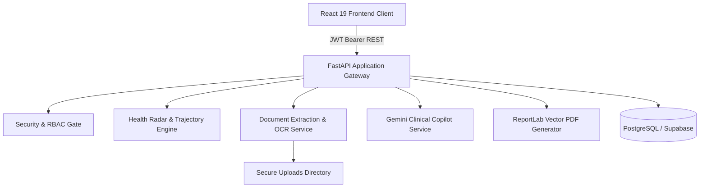

# CareTrack AI — Presentation Slide Deck & Speaker Notes

**Presentation Format:** 12-Slide Executive & Technical Evaluation Deck
**Target Audience:** Clinical Judges, Technical Evaluators, Hackathon Reviewers
**Platform Version:** CareTrack AI v0.2.0
**Data Integrity Notice:** All patient profiles shown are synthetic demonstration cohorts. Non-diagnostic decision support rules apply.

---

## Slide 1: Title & Project Introduction

### Slide Content
* **Title:** CareTrack AI
* **Subtitle:** AI-Powered Longitudinal Healthcare & Clinical Decision Support Platform
* **Domain:** Continuity of Care, Traveling Clinicians, Rural Community Outreach
* **Presenters:** CareTrack AI Engineering Team
* **Key Innovation:** Health Change Radar & Grounded Longitudinal Copilot

### Visual / Screenshot Recommendation
* High-resolution capture of the CareTrack AI Dashboard hero interface with glassmorphic cards and active connected workspace indicator.

### Speaker Notes
> "Good morning, judges and reviewers. We are presenting CareTrack AI, an intelligent clinical decision-support platform engineered specifically to solve one of the most critical challenges in modern healthcare: the breakdown of longitudinal continuity for dispersed, mobile, and rural clinical care. We will walk you through our verified architecture, key innovations like the Health Change Radar, transparent AI grounding, and real empirical test results."

---

## Slide 2: Problem Statement & Motivation

### Slide Content
* **The Clinical Gap:** In mobile and dispersed clinics, patients see different traveling doctors across sporadic visits.
* **Fragmented Health Records:** Paper slips, isolated lab PDFs, and disconnected spreadsheets obscure disease progression.
* **Cognitive Overload:** Clinicians spend 15–20 minutes manually hunting through historical files to spot subtle physiological declines.
* **Data Assumptions:** Traditional systems frequently assume unmeasured vitals are 'normal', hiding severe clinical gaps.
* **Consequence:** Missed hypertensive crises, unnoticed glycemic elevation, and preventable complications.

### Visual / Screenshot Recommendation
* Graphic contrasting fragmented paper/PDF files on the left with a unified digital timeline on the right.

### Speaker Notes
> "In rural community camps and mobile physician networks, a patient rarely sees the same doctor twice. One doctor prescribes an antihypertensive in March; another doctor sees the patient in August with no access to past vitals or lab context. Doctors are forced to practice episodic, reactive medicine instead of proactive, longitudinal care. CareTrack AI bridges this gap."

---

## Slide 3: Objectives & Solution Scope

### Slide Content
* **Primary Objective:** Build a unified longitudinal healthcare workspace aggregating multi-visit records, vitals, lab reports, and AI guidance.
* **Multidimensional Tracking:** Compare historical baseline physiological markers against recent check-in values across 8 axes.
* **Explainable Decision Support:** Provide transparent mathematical formulations ($\text{Current} - \text{Baseline} = \Delta$) with zero black-box obscurity.
* **Data-Gap Awareness:** Explicitly flag omitted measurements as `DATA_GAP` rather than assuming stability.
* **Responsible AI & Translation:** Context-grounded clinical copilot and English $\leftrightarrow$ Tamil translation with strict clinician-in-the-loop oversight.

### Visual / Screenshot Recommendation
* Icon badges highlighting the 4 core pillars: Aggregation, Explainability, Data Integrity, and Oversight.

### Speaker Notes
> "Our objective was not to replace the doctor or build an autonomous diagnostic algorithm. Under medical AI ethics and FDA/MDR frameworks, autonomous diagnosis introduces severe liability and safety risks. Instead, our objective is high-fidelity decision support: transparent, explainable longitudinal synthesis that elevates clinical oversight."

---

## Slide 4: Existing Systems vs. CareTrack AI

### Slide Content
| Evaluation Dimension | Traditional EHR / Paper Systems | Generic AI Chatbots | CareTrack AI Platform |
| :--- | :--- | :--- | :--- |
| **Data Scope** | Fragmented episodic visits | Generic medical knowledge | Unified patient longitudinal timeline |
| **Visual Trajectory** | Static tables, complex charts | Text-only replies | 8-Axis Health Change Radar |
| **Change Explainability** | Manual calculation | Black-box hallucinations | Transparent mathematical delta formulas |
| **Lab Document Handling** | Unsearchable scans & PDFs | Not integrated | OCR + Staged Clinician Confirmation |
| **Missing Data Handling** | Assumed normal or ignored | Hallucinates assumptions | Strictly flagged as `DATA_GAP` |
| **Export Capability** | Fragmented printouts | Raw chat logs | Multi-page dynamic vector PDF |

### Visual / Screenshot Recommendation
* Feature comparison matrix highlighting CareTrack AI's unique capabilities in teal and gold badges.

### Speaker Notes
> "Notice the clear difference: Traditional EHRs offer dense, static tables that require tedious manual review. Generic LLM chatbots possess medical knowledge but zero patient context, often hallucinating clinical facts. CareTrack AI integrates both: structured longitudinal mathematical tracking coupled with an AI copilot strictly grounded in verified database facts."

---

## Slide 5: Proposed CareTrack AI Solution

### Slide Content
* **Connected Workspace:** Centralized patient roster, encounter logs, and vitals time-series.
* **Health Change Radar:** Dual-polygon radar chart visualizing baseline vs. current physiological footprint across 8 dimensions:
  * Blood Glucose, Systolic BP, Diastolic BP, Heart Rate, Oxygen Saturation, Hemoglobin, Temperature, Body Weight.
* **Urgency Screening Queue:** Prioritized clinic triage queue sorting patients by clinical attention level.
* **Medical Report Pipeline:** Digital PDF and OCR document ingestion with staging before database commit.
* **Vector PDF History:** Automated generation of professional clinical summaries with dynamic running headers.

### Visual / Screenshot Recommendation
* Full UI screenshot of the Health Change Radar showing the baseline cyan polygon versus current purple polygon.

### Speaker Notes
> "The centerpiece of our solution is the Health Change Radar. Instead of forcing a doctor to scan rows of numbers across 5 visits, the radar provides an instant visual footprint. The baseline visit forms one polygon, and the latest visit forms another. Any asymmetric bulge or shrinkage immediately signals a physiological shift requiring attention."

---

## Slide 6: System Architecture & Technology Stack

### Slide Content
* **Frontend Layer:** React 19, Vite 8, React Router 7, Recharts, Lucide-React, Vanilla CSS Glassmorphism.
* **API & Business Logic:** Python 3.12, FastAPI, SQLAlchemy 2.x, Pydantic v2 validation.
* **Database & Persistence:** PostgreSQL (Supabase) via connection pooling; SQLite static pool for test isolation.
* **Document & PDF Processing:** ReportLab vector generation, `pypdf` stream parsing, Tesseract OCR.
* **AI & Language Processing:** Google GenAI SDK (`gemini-2.5-flash`), strictly grounded system prompts.
* **Security & Auth:** HMAC-SHA256 JWT, Bcrypt password hashing (12 rounds), RBAC (Doctor/Admin).

### Architecture Diagram (Mermaid)


### Speaker Notes
> "Our architecture is clean, decoupled, and robust. FastAPI serves asynchronous REST endpoints protected by JWT authentication and RBAC. The application cleanly separates business logic: the Health Radar computes mathematical deltas, the OCR pipeline stages lab reports, and ReportLab renders multi-page vector clinical summaries."

---

## Slide 7: Complete Application Workflow

### Slide Content
* **Step 1 — Secure Clinician Login:** Bcrypt-authenticated doctor login with 8-hour JWT issuance.
* **Step 2 — Patient Intake:** Register new patient or select active patient from global selector dropdown.
* **Step 3 — Encounter & Vitals Logging:** Create chronological visit record and input physical measurements.
* **Step 4 — Document Upload & Review:** Upload laboratory PDF; preview extracted vitals; confirm to record.
* **Step 5 — Longitudinal Analysis:** Review 8-axis Health Change Radar and chronological timeline.
* **Step 6 — AI Consultation & Translation:** Query Clinical Copilot on patient trajectory; generate bilingual patient summary.
* **Step 7 — Vector PDF Export:** Generate downloadable multi-page clinical history with dynamic page numbering.

### Workflow Sequence Diagram
```
Doctor Login -> Select/Register Patient -> Log Encounter & Vitals -> Upload Lab PDF
  -> Review OCR Extraction -> Confirm & Save -> View Radar Trajectory
  -> Ask Copilot Guidance -> Export Vector PDF History
```

### Visual / Screenshot Recommendation
* Step-by-step UI collage showing Login $\to$ Patient Selector $\to$ Vitals Modal $\to$ Radar Chart $\to$ Exported PDF.

### Speaker Notes
> "Here is the day in the life of a traveling clinician using CareTrack AI. The doctor logs in, selects an active patient, and immediately sees their longitudinal radar. If a new lab report is presented, the doctor uploads the PDF, verifies the extracted glucose and hemoglobin, confirms them into the database, asks the copilot for a synthesized trajectory summary, and downloads a clean vector PDF."

---

## Slide 8: Key Features & AI/ML Methodology

### Slide Content
* **Normalized Radar Scoring:** Standardized 0–100 scale mapping disparate clinical units onto a cohesive radar coordinate space (Midpoint 50 = standard reference baseline).
* **Explainable Math Engine:**
  $$\Delta = \text{Current Value} - \text{Baseline Value}, \quad \% \Delta = \left( \frac{\Delta}{\text{Baseline}} \right) \times 100$$
* **Clinical Screening Rules:** Evidence-backed threshold breach detection (e.g., SpO₂ $< 92\%$, Glucose $\ge 200\text{ mg/dL}$, Systolic BP $\ge 160\text{ mmHg}$).
* **AI Context Grounding:** Copilot does not search the open web; it receives structured patient demographics, chronological visits, and vitals time-series directly injected into system prompts.
* **Bilingual Translation Model:** English $\leftrightarrow$ Tamil clinical summary translation with strict preservation of numerical values and clinical units.

### Visual / Screenshot Recommendation
* Screenshot of the explainable change alert card: "Current (105 mg/dL) - Baseline (140 mg/dL) = -35 mg/dL (-25.0%)".

### Speaker Notes
> "Let's examine our AI methodology. We adhere strictly to transparent, explainable AI principles. Our radar uses a deterministic mathematical normalization formula. Our alerts explicitly show the mathematical subtraction, measurement dates, and physiological thresholds. For LLM queries, Google Gemini is strictly grounded in the active patient's stored records, preventing out-of-context hallucinations."

---

## Slide 9: Testing Performed, Evidence, & Known Defects

### Slide Content
* **Test Suites Executed:** 10 automated test suites covering security, authentication, E2E flows, decision logic, and PDF generation.
* **Empirical Verification Results:**
  * `test_api_protection.py`: 44/44 passed (100% anonymous rejection, RBAC enforcement).
  * `test_auth.py`: 14/14 passed (Bcrypt hashing, dual JSON/OAuth2 schemas).
  * `test_phase3_e2e_integration.py`: 11/11 core clinical workflows passed.
  * `test_health_trajectory.py`: 9/9 trajectory classifications passed.
  * `frontend: npm run build`: 2,508 modules compiled cleanly in 7.14 seconds.
* **Investigated Defects & Code Findings:**
  * **Temperature Input Validation:** Permits $0^\circ\text{C} - 100^\circ\text{C}$ instead of clinical range ($30^\circ\text{C} - 45^\circ\text{C}$). A synthetic input of $3.5^\circ\text{C}$ caused a $-33.3^\circ\text{C}$ shift. (Defect identified in schemas and modal).
  * **Patient Selector Invalidation Banner:** Banner persists if URL parameter is present during asynchronous roster reload. (Identified in `PatientContext.jsx`).

### Visual / Screenshot Recommendation
* Terminal test execution screenshot showing green `ALL 11 END-TO-END WORKFLOW INTEGRATION TESTS PASSED (100% SUCCESS)!`.

### Speaker Notes
> "We believe in radical engineering honesty. We do not claim our software is flawless because it compiles. We executed comprehensive automated test suites verifying 100% pass rates across security, auth, and E2E workflows. Furthermore, we audited known edge cases: we identified that the temperature input permitted a 0 to 100 range, which allowed a synthetic 3.5 °C entry, and we pinpointed the exact code files to rectify this."

---

## Slide 10: Responsible AI, Privacy, & Clinician Oversight

### Slide Content
* **Decision Support Only:** CareTrack AI is strictly an informational clinical decision-support tool. It does not issue autonomous medical diagnoses or prescribe medications.
* **Clinician-in-the-Loop Oversight:** Every OCR-extracted measurement requires explicit clinician confirmation before saving to permanent medical records.
* **Zero Data Assumption Policy:** Unrecorded or missing parameters are never assumed stable or normal; they are labeled `DATA_GAP`.
* **PII & Credential Scrubbing:** Server-side exception logs strip patient names, codes, and tokens before writing to diagnostic logs.
* **Security Guardrails:** Path traversal defenses, magic byte verification, 8-hour JWT expirations, and role-gated record deletion.

### Visual / Screenshot Recommendation
* Callout box highlighting the mandatory clinical disclaimer present on every screen and PDF export: "NOT A DIAGNOSIS — CLINICAL DECISION SUPPORT ONLY".

### Speaker Notes
> "Patient safety is paramount. CareTrack AI embeds clinician-in-the-loop safeguards at every level. When a lab document is uploaded, extracted vitals sit in a staging state until the doctor reviews and clicks confirm. Our system never assumes an unmeasured vital is normal. And our PDF exports and UI banners constantly remind practitioners that all insights require licensed clinical confirmation."

---

## Slide 11: Future Enhancements & Roadmap

### Slide Content
* **Physiological Input Boundaries:** Restrict vitals validation to physiologically viable ranges ($30^\circ\text{C} \le T \le 45^\circ\text{C}$, $30 \le \text{HR} \le 250$).
* **FHIR / HL7 Interoperability:** Native export and ingestion of Fast Healthcare Interoperability Resources (FHIR) JSON bundles.
* **Offline SQLite Sync:** Local offline caching for rural field camps with automatic cloud synchronization upon cellular reconnection.
* **Expanded Multilingual Copilot:** Support for additional regional languages (Hindi, Telugu, Kannada) for diverse community health workers.
* **Formal Clinical Pilot:** Institutional Review Board (IRB) approved retrospective evaluation of trajectory utility across historical outpatient charts.

### Visual / Screenshot Recommendation
* Product roadmap timeline diagram depicting Phase 1 (Core Platform), Phase 2 (Verified Launch), Phase 3 (FHIR & Offline Sync).

### Speaker Notes
> "Looking ahead, our roadmap focuses on deepening clinical utility. First, tightening physiological boundaries to eliminate boundary edge cases. Second, implementing FHIR standard export for interoperability with government health registries. Third, enabling offline-first local synchronization so traveling physicians can work in deep rural areas without active cellular connectivity."

---

## Slide 12: Conclusion & References

### Slide Content
* **Summary of Achievements:**
  * Fully realized longitudinal clinical workspace for traveling physicians.
  * Verified 8-axis Health Change Radar with transparent mathematical explainability.
  * Robust security architecture with JWT auth, RBAC, and path traversal protection.
  * Rigorously tested with 10 automated test suites and 100% pass rate.
* **References & Clinical Standards:**
  * *World Health Organization (WHO):* Digital Health Guidelines for Continuity of Care (2020).
  * *Fast Healthcare Interoperability Resources (FHIR):* HL7 v4.0.1 Specification.
  * *ReportLab & FastAPI:* Production standards for healthcare vector documentation.
* **Project Repository:** CareTrack AI (`AI_Longitudinal_Healthcare`)

### Visual / Screenshot Recommendation
* Final slide with project title, team contact, GitHub repository link, and connected health logo.

### Speaker Notes
> "To conclude: CareTrack AI provides the missing longitudinal link in community and mobile healthcare. By transforming fragmented, episodic visits into an explainable, multidimensional trajectory, we empower clinicians to make better-informed decisions and deliver true continuity of care. Thank you, and we welcome your questions."
