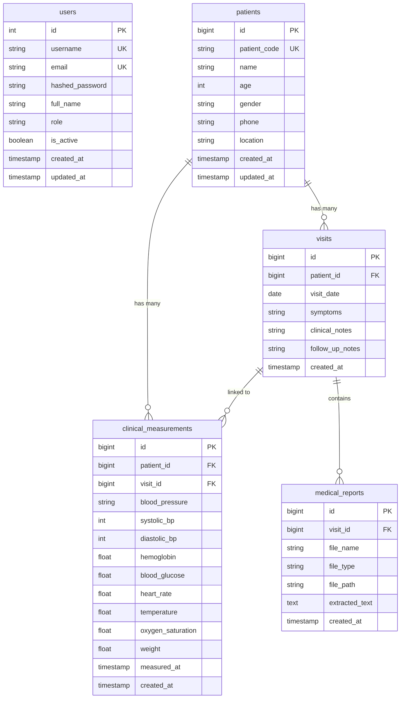

# CareTrack AI — Complete Project Documentation & Technical Architecture

**Platform Name:** CareTrack AI — AI Longitudinal Healthcare Platform
**Version:** 0.2.0
**Target Domain:** Longitudinal Patient Monitoring, Clinical Decision Support, Mobile Outreach & Primary Healthcare
**Author / Engineering Team:** CareTrack AI Platform Team
**Documentation Date:** October 2026

---

## 1. Project Title & Problem Statement

### 1.1 Project Title
**CareTrack AI: An Explainable Longitudinal Clinical Decision-Support Platform for Mobile Clinicians and Dispersed Healthcare Practices**

### 1.2 Problem Statement
In mobile clinics, rural community outreach camps, and decentralized ambulatory healthcare systems, patients rarely encounter the same healthcare practitioner across successive visits. Clinical records are routinely fragmented across physical paper cards, detached digital spreadsheets, and isolated PDF laboratory reports. As a result:
1. **Loss of Longitudinal Context:** Traveling physicians treat patient encounters as isolated, episodic events, lacking continuous visibility into prior physiological baselines, symptom trajectories, or past medication plans.
2. **Delayed Detection of Clinical Deterioration:** Slowly progressive chronic conditions (e.g., escalating essential hypertension, worsening glycemic control in type-2 diabetes, gradual post-infectious anemia) go unnoticed until acute crises develop.
3. **Cognitive Burden on Clinicians:** Physicians must manually inspect disparate historical documents during brief 10-to-15 minute encounter windows, leading to diagnostic oversight and fatigue.
4. **Dangerous Data Assumptions:** Conventional clinical record systems frequently treat unrecorded or missing parameters as "normal" or omit them silently, masking severe diagnostic data gaps.

---

## 2. Motivation & Objectives

### 2.1 Motivation
Continuity of care is clinically established as a direct predictor of reduced hospital admissions, improved chronic disease control, and reduced mortality. However, in low-resource and mobile clinical settings, longitudinal tracking tools designed for tertiary hospital systems fail due to heavy infrastructure requirements, complex proprietary workflows, and lack of visual explainability. CareTrack AI was created to provide a lightweight, accessible, yet medically rigorous decision-support platform tailored for the workflows of traveling and community physicians.

### 2.2 Objectives
1. **Longitudinal Synthesis:** Aggregate patient demographics, chronological encounter logs, vital signs, and unstructured laboratory reports into a unified clinical workspace.
2. **Multidimensional Visual Trajectory:** Provide a rapid-glance physiological radar (Health Change Radar) that maps 8 vital axes on a standardized 0–100 coordinate plane, contrasting baseline and current patient states.
3. **Mathematical Explainability:** Eliminate black-box opacity by displaying exact mathematical deltas ($\text{Current} - \text{Baseline} = \Delta$) with measurement date provenance and threshold-breach clinical rationale.
4. **Data-Gap Awareness:** Prevent false clinical assurances by explicitly categorizing unrecorded vitals as `DATA_GAP` instead of assuming physiological normality.
5. **Grounded AI Copilot:** Deliver context-aware clinical question answering powered by LLMs grounded strictly in the active patient's stored longitudinal database records.
6. **Bilingual Accessibility:** Provide bilingual English $\leftrightarrow$ Tamil summary generation to bridge communication barriers in diverse regional healthcare camps.
7. **Vector Document Export:** Dynamically compile multi-page, audit-ready clinical histories in vector PDF format featuring dynamic running page numbers and clinical disclaimers.

---

## 3. Target Users & Real-World Use Cases

### 3.1 Primary User Personas
* **Traveling Physicians / Mobile Doctors:** Doctors conducting periodic outreach rounds across rural village health posts who need immediate longitudinal context on previously unseen patients.
* **Community Health Workers (CHWs) & Nurses:** Healthcare staff registering patients, taking standard intake vital signs, uploading lab reports, and triaging priority cases.
* **Primary Care Physicians (PCPs):** Outpatient clinic doctors monitoring multi-visit trajectories for chronic diseases (hypertension, diabetes, cardiopulmonary disorders).
* **Clinical Clinic Administrators:** Staff overseeing clinic urgency queues, ensuring patient roster integrity, and auditing record modifications.

### 3.2 Real-World Clinical Use Case Workflow
1. **Intake & Triage:** A patient arrives at a mobile clinic post in a rural taluk. The community nurse searches the patient roster or registers the patient with a unique identifier (`DEMO-CARE-103`).
2. **Vitals Recording:** The nurse logs systolic/diastolic blood pressure, capillary blood glucose, resting heart rate, pulse oximetry (SpO₂), body temperature, hemoglobin, and weight.
3. **Lab Document Ingestion:** The patient presents a physical laboratory blood test slip. The staff uploads a photograph or digital PDF. The platform extracts hemoglobin and glucose values, staging them for doctor review.
4. **Physician Review & Health Radar Analysis:** The traveling physician logs in, opens the patient workspace, and inspects the Health Change Radar. An asymmetric outward shift along the systolic BP and blood glucose axes instantly signals hypertensive and diabetic escalation.
5. **Explainable Change Verification:** The doctor inspects the radar metric card: `Current (165 mmHg on 2026-10-15) - Baseline (130 mmHg on 2026-04-10) = +35 mmHg (+26.9%)`. The system flags `HIGH_ATTENTION / ELEVATED_SHIFT`.
6. **Grounded Copilot Query:** The physician queries the Clinical Copilot: *"Summarize the glycemic and cardiovascular changes since April and review documented symptoms."* The copilot provides a grounded chronological answer citing database records.
7. **Patient Summary & Export:** The physician generates a Tamil-language patient summary for the patient's family and exports a 2-page vector PDF history for the patient's physical file.

---

## 4. Existing Systems & Limitations

| System Category | Operational Characteristics | Critical Limitations in Mobile/Longitudinal Care |
| :--- | :--- | :--- |
| **Paper-Based Health Books** | Physical booklets carried by patients | Easily lost, soiled, or damaged; no trend analysis, alert generation, or duplicate prevention. |
| **Traditional Hospital EHRs** (Epic, Cerner) | Heavy client-server tertiary hospital systems | Prohibitively expensive; requires high-bandwidth infrastructure; complex menus ill-suited for rapid field clinics. |
| **Spreadsheets / Google Sheets** | Tabular data entry by local health staff | High data-entry error rates; no physiological validation; no visual trajectories; zero HIPAA-grade RBAC. |
| **Generic Consumer AI Chatbots** | Web-based LLM chat interfaces | Zero access to patient database records; severe risk of clinical hallucination; ungrounded medical advice. |

---

## 5. Proposed CareTrack AI System

CareTrack AI bridges these gaps by combining lightweight web accessibility with clinical decision-support rigor:
* **Centralized Data Model:** Patients, chronological visits, multi-metric vitals, and medical reports are linked through strict relational foreign keys.
* **Standardized 8-Axis Radar:** Converts heterogeneous clinical units (mmHg, mg/dL, bpm, %, °C, kg) into a unified normalized 0–100 coordinate geometry.
* **Deterministic Math Over Speculation:** Trajectory analysis uses deterministic arithmetic comparisons rather than stochastic predictions.
* **Clinician-in-the-Loop Safeguards:** All OCR extractions must be reviewed and confirmed by a clinician prior to permanent recording.
* **Zero Data Assumption Policy:** If an oxygen saturation measurement is omitted, it is labeled `DATA_GAP (MISSING_CURRENT)` and never interpolated as normal.

---

## 6. Technology Stack & Frameworks

### 6.1 Backend
* **Language & Runtime:** Python 3.12 (64-bit)
* **API Framework:** FastAPI v0.115+ (Asynchronous ASGI framework)
* **Data Validation & Schemas:** Pydantic v2 & Pydantic-Settings
* **ORM & Database Toolkit:** SQLAlchemy 2.x
* **Database Driver:** `psycopg` (binary, version 3.x)
* **Authentication & Cryptography:** `bcrypt` (v4.2+), `pyjwt` (v2.9+)
* **Document Processing:** `reportlab` (v4.x) for vector PDF compilation, `pypdf` (v5.x) for digital PDF text stream parsing, `pytesseract` & `Pillow` for OCR image preprocessing
* **AI & LLM Client:** Google GenAI SDK (`google-genai`) calling `gemini-2.5-flash`

### 6.2 Frontend
* **Core Library & Runtime:** React 19, JavaScript (ES2023)
* **Build Tool & Dev Server:** Vite 8.3.4
* **Routing:** React Router v7 (`react-router-dom`)
* **Visualization Engine:** Recharts v2 (Responsive RadarChart, LineChart, PolarGrid, PolarAngleAxis)
* **Iconography:** Lucide-React
* **Styling Architecture:** Pure Vanilla CSS design system with CSS custom properties, glassmorphism, responsive grid layouts, and zero external CSS framework bloat

### 6.3 Database & Cloud Storage
* **Production Database:** PostgreSQL 15+ hosted on Supabase (connection pooler on port 6543, pool pre-ping, pool recycle 1800s)
* **Test Database:** In-memory SQLite with `StaticPool` and compiler overrides for isolated, non-destructive test execution
* **File Storage:** Local secure filesystem directory (`backend/uploads/medical_reports/`) with absolute path traversal containment

---

## 7. System Architecture & Data Flow

### 7.1 Architecture Diagram
```mermaid
graph TD
    subgraph Client Layer [Frontend Client - React 19 / Vite 8]
        UI[User Interface & Router]
        PC[PatientContext & AuthContext]
        RDR[Recharts Radar & Trends]
    end

    subgraph Security Layer [FastAPI Security & RBAC Gate]
        JWT[JWT Bearer Token Validator]
        RBAC[Role-Based Access Guard - Doctor vs Admin]
        SEC[Directory Traversal & MIME Check]
    end

    subgraph API Routers [FastAPI Application Controllers]
        R_AUTH[auth.py]
        R_PAT[patient.py]
        R_VIS[visit.py]
        R_MEAS[clinical_measurement.py]
        R_RAD[health_radar.py]
        R_TRAJ[health_trajectory.py]
        R_REP[medical_report.py]
        R_COP[clinical_copilot.py]
        R_TRANS[clinical_translation.py]
        R_ALT[clinical_alerts.py]
    end

    subgraph Services & Processing Engines
        SRV_RAD[Radar & Trajectory Engine]
        SRV_OCR[OCR & Regex Clinical Extraction]
        SRV_PDF[ReportLab Vector PDF Engine]
        SRV_AI[Google Gemini 2.5 Flash Client]
    end

    subgraph Persistence Layer
        DB[(PostgreSQL / Supabase)]
        FS[(Local Secure File System - uploads/)]
    end

    UI -->|HTTP Bearer| JWT
    JWT --> RBAC
    RBAC --> API Routers
    R_AUTH --> DB
    R_PAT --> DB
    R_VIS --> DB
    R_MEAS --> DB
    R_RAD --> SRV_RAD
    SRV_RAD --> DB
    R_REP --> SEC
    SEC --> FS
    R_REP --> SRV_OCR
    R_REP --> DB
    R_COP --> SRV_AI
    SRV_AI --> DB
    R_TRANS --> SRV_AI
    R_PAT --> SRV_PDF
    SRV_PDF --> DB
```

### 7.2 Core Data Flow Sequences
1. **Authentication Flow:** User submits credentials $\to$ Bcrypt validates salted hash $\to$ JWT signed with HMAC-SHA256 (480-minute expiry) returned $\to$ Client stores token in `sessionStorage` and attaches `Authorization: Bearer <token>` to all subsequent requests.
2. **Measurement Intake & Duplicate Guard:** Measurement payload validated against Pydantic schema $\to$ System queries existing measurements for `(patient_id, visit_id)` $\to$ If all non-null values match an existing record, HTTP 409 Conflict is returned $\to$ Otherwise record committed to `clinical_measurements`.
3. **Health Radar Computation:** Query chronological visits and measurements for `patient_id` $\to$ Designate earliest visit as Baseline ($B$) and latest visit as Current ($C$) $\to$ Compute continuous piecewise normalization for 8 axes $\to$ Compute exact delta $\Delta = C - B$ and percentage shift $\to$ Evaluate threshold breach rules $\to$ Generate factual summary narrative and action suggestions $\to$ Return structured JSON to Recharts client.

---

## 8. Complete Application Workflow

```
[1. Login] -> [2. Dashboard] -> [3. Select / Register Patient]
      |                               |
      v                               v
[Urgency Queue]             [Encounter Visit Intake]
                                      |
                                      v
                          [Clinical Measurements Entry]
                                      |
         +----------------------------+----------------------------+
         |                            |                            |
         v                            v                            v
[Health Change Radar]       [Medical Report Upload]       [Clinical Trends Chart]
         |                            |                            |
         v                            v                            v
[Explainable Deltas]        [OCR Review & Staging]        [Historical Line Graphs]
         |                            |                            |
         +----------------------------+----------------------------+
                                      |
                                      v
                        [Clinical Copilot Inquiry]
                                      |
                                      v
                       [Bilingual Tamil Translation]
                                      |
                                      v
                      [Vector PDF Patient Export]
```

1. **Clinician Authentication (`/login`):** Clinician signs in using username or email and password.
2. **Dashboard Overview (`/`):** View quick actions, system connection status, and active patient summary.
3. **Active Patient Selection:** The global `PatientSelector` dropdown maintains the active patient across routes. If none exists, the doctor registers a patient via `PatientRegistrationModal`.
4. **Clinical Encounter Registration:** The doctor logs encounter date, presenting symptoms, clinical notes, and follow-up plans via `VisitRegistrationModal`.
5. **Physical Measurements Entry:** Vitals are logged via `ClinicalMeasurementModal`. Timestamp discrepancies between visit dates and measurement dates trigger automatic warning flags.
6. **Laboratory Document Ingestion (`/reports`):** Doctor uploads a patient lab document. The system extracts selectable text via `pypdf` or OCR via `Tesseract`. Extracted vitals are staged in a review card. The doctor verifies and confirms the values into the patient record.
7. **Health Change Radar Analysis (`/radar`):** Visual comparison of baseline vs current visit across 8 physiological axes. Interactive metric cards display exact mathematical formulas, clinical reasons, and recommended action steps.
8. **Longitudinal Trends Visualization (`/trends`):** Multi-point chronological line graphs showing trendlines over time for glucose, BP, heart rate, and oxygen saturation.
9. **Clinical Alerts & Urgency Dashboard (`/alerts`):** Triage view of all registered patients ranked by alert severity (`high`, `moderate`, `data_gap`, `normal`).
10. **Clinical Copilot Consultation (`/copilot`):** Doctor queries Google Gemini regarding patient trajectory. The assistant answers based exclusively on injected database records.
11. **Bilingual Clinical Translation:** English clinical summaries are converted into Tamil (and vice-versa) with strict preservation of numerical vitals.
12. **Vector PDF Clinical History Export:** Single-click generation of a multi-page vector PDF history compiled dynamically from database records via ReportLab.

---

## 9. Implemented Codebase Modules

| Module Path | Layer | Purpose & Responsibilities |
| :--- | :--- | :--- |
| `backend/app/main.py` | App Factory | Configures FastAPI app, CORS middleware, global auth dependencies, and mounts 12 API routers. |
| `backend/app/database.py` | Persistence | Configures SQLAlchemy engine, sessionmaker, pool recycling, settings loading from `.env`. |
| `backend/app/security.py` | Security | Bcrypt password hashing, constant-time verification, HMAC-SHA256 JWT encoding and decoding. |
| `backend/app/api/auth.py` | Controller | Handles `POST /auth/login` (JSON & OAuth2 form) and `GET /auth/me`. |
| `backend/app/api/deps.py` | Middleware | Extracts Bearer token, validates claims, resolves active DB user, enforces `require_role`. |
| `backend/app/api/patient.py` | Controller | Patient CRUD, unique code validation, and dynamic ReportLab PDF export. |
| `backend/app/api/visit.py` | Controller | Chronological visit logging, patient-visit relationship querying, reverse chronological sorting. |
| `backend/app/api/clinical_measurement.py` | Controller | Vitals recording, duplicate submission rejection (HTTP 409), timestamp divergence checks. |
| `backend/app/api/health_radar.py` | Controller | 8-axis Health Change Radar, continuous piecewise normalization, explainable mathematical delta engine. |
| `backend/app/api/health_trajectory.py` | Controller | Multi-visit trajectory classification (improving, stable, concerning, insufficient, data gap). |
| `backend/app/api/clinical_alerts.py` | Controller | Patient screening alerts and clinic-wide prioritized urgency queue triage (`/clinical-alerts/overview`). |
| `backend/app/api/medical_report.py` | Controller | Multipart file upload, magic byte verification, directory traversal defense, staged OCR confirmation. |
| `backend/app/api/clinical_copilot.py` | Controller | Context-grounded clinical question answering with Google Gemini, PII scrubbing in exception handlers. |
| `backend/app/api/clinical_translation.py` | Controller | Bilingual English $\leftrightarrow$ Tamil translation with numerical and clinical unit preservation. |
| `backend/app/api/clinical_trend.py` | Controller | Chronological trendline data point generation for Recharts visualization. |
| `backend/app/api/timeline.py` | Controller | Unified longitudinal patient timeline combining visits, vitals, and attached documents. |
| `backend/app/services/pdf_generator_service.py` | Service | ReportLab multi-page vector PDF document builder with custom two-pass `NumberedCanvas`. |
| `backend/app/services/clinical_extraction_service.py` | Service | Medical regex rule extractor parsing vitals from normalized document text strings. |
| `backend/app/services/medical_report_service.py` | Service | PDF text stream extraction (`pypdf`) and image OCR preprocessing (`pytesseract`, Pillow). |
| `frontend/src/context/AuthContext.jsx` | Client State | JWT token persistence in `sessionStorage`, login/logout handlers, authenticated profile state. |
| `frontend/src/context/PatientContext.jsx` | Client State | Global patient roster state, active patient selection, URL query parameter synchronization. |
| `frontend/src/components/HealthChangeRadar.jsx` | UI Component | Interactive dual-polygon Recharts radar chart, metric card selector, and copilot banner. |
| `frontend/src/components/PatientSelector.jsx` | UI Component | Global dropdown header, quick demographics badge, PDF download button, invalid patient banner. |
| `frontend/src/components/ClinicalMeasurementModal.jsx` | UI Modal | Form for entering 8 vitals with input hints and client-side boundary validation. |
| `frontend/src/pages/ClinicalAlertsDashboard.jsx` | UI Page | Triage dashboard displaying prioritized clinic roster, severity filters, and rule thresholds. |
| `frontend/src/pages/ClinicalCopilot.jsx` | UI Page | Chat workspace with sample clinical prompt chips and grounded conversational streaming. |
| `frontend/src/pages/MedicalReports.jsx` | UI Page | Drag-and-drop document uploader, extraction staging preview, and confirmed report archive. |
| `frontend/src/pages/ClinicalTrends.jsx` | UI Page | Interactive historical multi-metric line charts with metric toggles. |

---

## 10. Database Schema, Relationships, & Key Fields

The database schema consists of 6 primary relational tables:



### Table Definitions & Key Fields
1. **`users` (Clinician Accounts):**
   * `id`: Serial Primary Key
   * `username`: VARCHAR(50), Unique, Not Null
   * `email`: VARCHAR(120), Unique, Not Null
   * `hashed_password`: VARCHAR(255), Not Null (Bcrypt hash)
   * `role`: VARCHAR(20), Not Null, Default `'doctor'` (Enforces RBAC: `'doctor'` or `'admin'`)
   * `is_active`: BOOLEAN, Not Null, Default `TRUE`
2. **`patients` (Patient Demographics):**
   * `id`: BigInteger Primary Key, Autoincrement
   * `patient_code`: String, Unique, Not Null (e.g. `'DEMO-ARUN-001'`)
   * `name`: String, Not Null
   * `age`: Integer, Nullable
   * `gender`: String, Nullable (`'Male'`, `'Female'`, `'Other'`)
   * `phone`, `location`: String, Nullable
3. **`visits` (Clinical Encounters):**
   * `id`: BigInteger Primary Key, Autoincrement
   * `patient_id`: BigInteger, Foreign Key to `patients.id`, Not Null
   * `visit_date`: Date, Not Null (Encounter date)
   * `symptoms`, `clinical_notes`, `follow_up_notes`: String / Text, Nullable
4. **`clinical_measurements` (Physical Vitals & Laboratory Values):**
   * `id`: BigInteger Primary Key, Autoincrement
   * `patient_id`: BigInteger, Not Null
   * `visit_id`: BigInteger, Not Null
   * `systolic_bp`, `diastolic_bp`: Integer, Nullable (mmHg)
   * `blood_pressure`: String, Nullable (e.g. `'120/80'`)
   * `blood_glucose`: Float, Nullable (mg/dL)
   * `heart_rate`: Float, Nullable (bpm)
   * `temperature`: Float, Nullable (°C)
   * `oxygen_saturation`: Float, Nullable (SpO₂ %)
   * `hemoglobin`: Float, Nullable (g/dL)
   * `weight`: Float, Nullable (kg)
   * `measured_at`: Timestamp with Time Zone, Nullable (Encounter intake time)
5. **`medical_reports` (Uploaded Lab Documents):**
   * `id`: BigInteger Primary Key, Autoincrement
   * `visit_id`: BigInteger, Foreign Key to `visits.id`, Not Null
   * `file_name`: String, Not Null (Original uploaded filename)
   * `file_type`: String, Not Null (MIME type e.g. `'application/pdf'`)
   * `file_path`: String, Not Null (Server filesystem path)
   * `extracted_text`: Text, Nullable (Parsed digital or OCR text stream)

---

## 11. AI/ML Algorithms, Prompts, Calculations, & Thresholds

### 11.1 Continuous Piecewise Normalization for Radar Geometry
To plot diverse vital signs on a unified radar chart, CareTrack AI maps each metric to a continuous 0–100 scale where **50 represents the standard clinical reference baseline**:
* **Blood Glucose (mg/dL):** $f(x) = \text{clamp}(10.0 + \frac{x - 50}{200} \times 80.0)$ ($50 \to 10$, $100 \to 50$, $200 \to 85$, $250+ \to 100$)
* **Systolic BP (mmHg):** $f(x) = \text{clamp}(15.0 + \frac{x - 80}{100} \times 70.0)$ ($80 \to 15$, $120 \to 50$, $180 \to 90$)
* **Diastolic BP (mmHg):** $f(x) = \text{clamp}(15.0 + \frac{x - 50}{60} \times 70.0)$ ($50 \to 15$, $80 \to 50$, $110 \to 90$)
* **Heart Rate (bpm):** $f(x) = \text{clamp}(15.0 + \frac{x - 45}{75} \times 70.0)$ ($45 \to 15$, $75 \to 50$, $120 \to 90$)
* **Oxygen Saturation (%):** $f(x) = \text{clamp}(15.0 + \frac{x - 85}{15} \times 80.0)$ ($85 \to 15$, $95 \to 60$, $100 \to 95$)
* **Hemoglobin (g/dL):** $f(x) = \text{clamp}(15.0 + \frac{x - 7.0}{11.0} \times 80.0)$ ($7 \to 15$, $14 \to 65$, $18 \to 95$)
* **Body Temperature (°C):** $f(x) = \text{clamp}(20.0 + \frac{x - 35.5}{4.0} \times 75.0)$ ($35.5 \to 20$, $36.8 \to 50$, $39.5 \to 95$)
* **Weight (kg):** $f(x) = \text{clamp}(20.0 + \frac{x - 40.0}{80.0} \times 75.0)$ ($40 \to 20$, $70 \to 55$, $120 \to 95$)

### 11.2 Explainable Delta Formulation
For every metric $i$ where both baseline ($b$) and current ($c$) measurements exist:
$$\Delta_i = c_i - b_i, \quad \% \Delta_i = \left( \frac{c_i - b_i}{b_i} \right) \times 100$$
Output display string: `Current (c unit on date_c) - Baseline (b unit on date_b) = Delta unit (% Delta%)`.

### 11.3 Clinical Decision Support Screening Thresholds
* **Oxygen Saturation:** $c < 92.0\% \implies \text{HIGH\_ATTENTION} / \text{HYPOXIA\_CONCERN}$; $\Delta \le -4.0\% \implies \text{HIGH\_ATTENTION} / \text{SIGNIFICANT\_DROP}$.
* **Systolic BP:** $c \ge 160\text{ mmHg} \lor \Delta \ge 25\text{ mmHg} \implies \text{HIGH\_ATTENTION} / \text{ELEVATED\_SHIFT}$; $c < 90\text{ mmHg} \implies \text{HIGH\_ATTENTION} / \text{HYPOTENSIVE\_SHIFT}$; $c \ge 140\text{ mmHg} \lor \Delta \ge 15\text{ mmHg} \implies \text{MODERATE\_ATTENTION}$.
* **Blood Glucose:** $c < 70\text{ mg/dL} \implies \text{HIGH\_ATTENTION} / \text{HYPOGLYCEMIC\_SHIFT}$; $c \ge 200\text{ mg/dL} \lor \Delta \ge 30\text{ mg/dL} \implies \text{HIGH\_ATTENTION} / \text{GLYCEMIC\_ELEVATION}$; $c \ge 140\text{ mg/dL} \implies \text{MODERATE\_ATTENTION}$.
* **Heart Rate:** $c > 110\text{ bpm} \lor c < 50\text{ bpm} \implies \text{HIGH\_ATTENTION} / \text{TACHY\_BRADYCARDIA}$; $|\Delta| \ge 20\text{ bpm} \implies \text{MODERATE\_ATTENTION}$.
* **Hemoglobin:** $c < 11.0\text{ g/dL} \lor \Delta \le -2.0\text{ g/dL} \implies \text{HIGH\_ATTENTION} / \text{ANEMIA\_ALERT}$.
* **Body Temperature:** $c \ge 38.0^\circ\text{C} \implies \text{HIGH\_ATTENTION} / \text{FEVER\_DETECTED}$; $c < 35.5^\circ\text{C} \implies \text{MODERATE\_ATTENTION} / \text{HYPOTHERMIC\_SHIFT}$.
* **Body Weight:** $|\% \Delta| \ge 7.0\% \implies \text{HIGH\_ATTENTION} / \text{RAPID\_WEIGHT\_CHANGE}$; $|\% \Delta| \ge 4.0\% \implies \text{MODERATE\_ATTENTION}$.

### 11.4 LLM Grounding & Prompt Strategy (Clinical Copilot)
The system injects structured patient facts directly into the system prompt of Google Gemini (`gemini-2.5-flash`):
```text
You are CareTrack Copilot, a clinical decision-support assistant for traveling physicians.
Strict Constraints:
1. Base your response strictly on the structured clinical facts provided below.
2. If information is missing from the record, explicitly state that it is unrecorded.
3. Do not formulate autonomous medical diagnoses or prescribe drug dosages.
4. Always remind the clinician that these observations require independent verification.

Patient Profile: Name: {name}, Code: {code}, Age: {age}, Gender: {gender}
Recorded Visits:
{chronological_visit_list}
Measurement History:
{measurement_history_list}
Doctor's Clinical Question: {question}
```

---

## 12. Privacy, Security, & Responsible AI Disclaimers

1. **Non-Diagnostic Decision Support Disclaimer:**
   Every screen in CareTrack AI, every API summary, and every exported PDF carries the mandatory notice:
   > *"CareTrack AI is an informational clinical decision-support platform designed for qualified medical professionals. It does not provide automated medical diagnoses, triage triage scores, or treatment plans. Missing or omitted vital signs must never be assumed normal. All clinical findings must be independently confirmed by a licensed healthcare practitioner."*
2. **Clinician-in-the-Loop Review:**
   No OCR-extracted lab value or AI suggestion is ever automatically committed to a patient's permanent medical record without manual clinician review and approval.
3. **Data Protection & Boundary Defense:**
   * Passwords hashed using Bcrypt with 12 salt rounds.
   * Session tokens signed with HMAC-SHA256 (32+ character entropy).
   * Document downloads enforce directory traversal containment (`resolve().startswith(UPLOAD_DIR)`).
   * Server exception handlers strip patient PII and API keys from diagnostic logs.

---

## 13. Installation, Configuration, & Startup Instructions

### 13.1 Prerequisites
* Python 3.12+ (64-bit)
* Node.js 18+ and npm
* PostgreSQL 15+ (or Supabase account)
* Tesseract OCR executable (optional, for image OCR) installed at `C:\Program Files\Tesseract-OCR\tesseract.exe`

### 13.2 Backend Configuration & Startup
1. Navigate to the backend directory:
   ```bash
   cd backend
   ```
2. Create and activate a virtual environment:
   ```powershell
   python -m venv .venv
   .\.venv\Scripts\activate   # Windows PowerShell
   ```
3. Install dependencies:
   ```bash
   pip install -r requirements.txt
   ```
4. Configure environment variables in `backend/.env`:
   ```ini
  DATABASE_URL=postgresql://<username>:<password>@<host>:<port>/<database>
   SECRET_KEY=caretrack_ai_super_secret_jwt_key_2026_at_least_32_characters_long
   ALGORITHM=HS256
   ACCESS_TOKEN_EXPIRE_MINUTES=480
   GEMINI_API_KEY=your_gemini_api_key_here
   ```
5. Run the safe database migration:
   ```bash
   python scripts/migrate_add_users_table.py --execute
   ```
6. Start the FastAPI backend server:
   ```bash
   uvicorn app.main:app --host 127.0.0.1 --port 8000 --reload
   ```
   * Interactive API Documentation (Swagger UI): `http://127.0.0.1:8000/docs`
   * Health Check: `http://127.0.0.1:8000/health`

### 13.3 Frontend Configuration & Startup
1. Navigate to the frontend directory:
   ```bash
   cd frontend
   ```
2. Install npm dependencies:
   ```bash
   npm install
   ```
3. Start the Vite development server:
   ```bash
   npm run dev
   ```
   * Frontend Application: `http://localhost:5173`

### 13.4 Automated Test Suite Execution
Execute the full suite of automated verification tests:
```powershell
# 1. API Protection & Security RBAC Test (44 assertions)
.\backend\.venv\Scripts\python.exe backend/test_api_protection.py

# 2. Authentication & Bcrypt Verification (14 assertions)
.\backend\.venv\Scripts\python.exe backend/test_auth.py

# 3. Phase 3 End-to-End Workflow Integration (11 workflows)
.\backend\.venv\Scripts\python.exe backend/test_phase3_e2e_integration.py

# 4. HealthTrajectory Decision Logic (9 test suites)
.\backend\.venv\Scripts\python.exe backend/test_health_trajectory.py

# 5. Patient History Vector PDF Generation
.\backend\.venv\Scripts\python.exe backend/test_patient_pdf.py

# 6. Frontend Production Build Verification
cd frontend && npm run build
```
